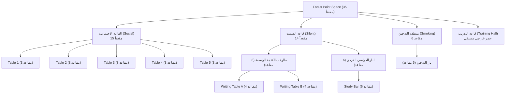
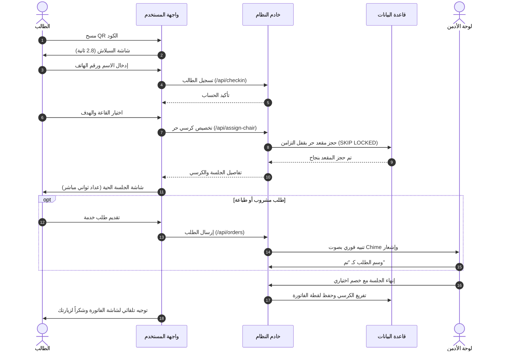
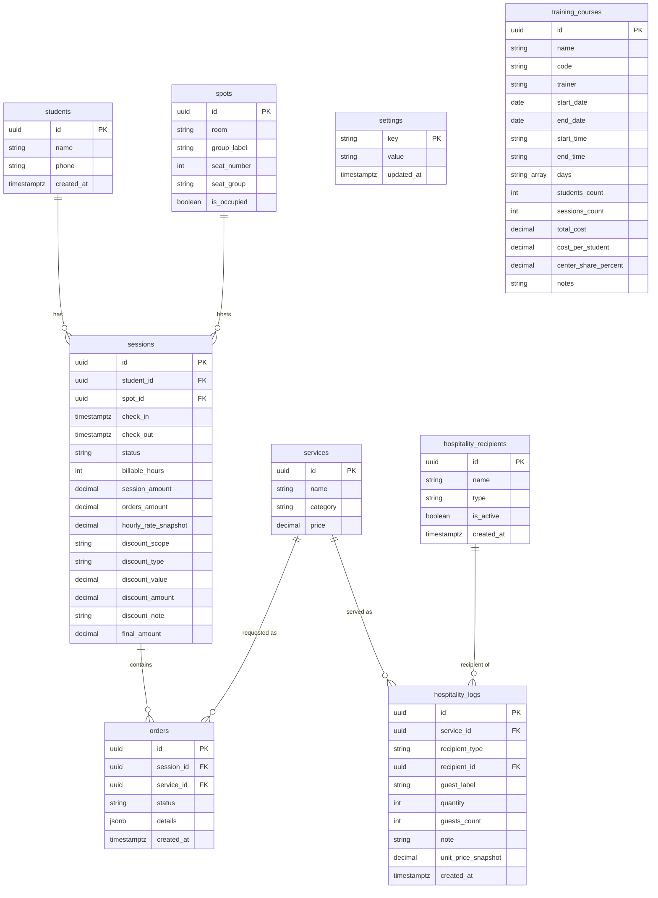

# دليل الهوية الشامل والمواصفات الفنية — Focus Point
> **المرجع المتكامل للهوية البصرية، التجربة المكانية، المنطق المالي، وقواعد بناء الموقع الجديد لنفس المكان.**

---

## فهرس المحتويات
1. [نظرة عامة وهوية المكان (Brand Core & Overview)](#1-نظرة-عامة-وهوية-المكان)
2. [الهوية البصرية ونظام التصميم (Visual Identity & Design Tokens)](#2-الهوية-البصرية-ونظام-التصميم)
3. [الأصول الرقمية والشعارات (Logos & Brand Assets)](#3-الأصول-الرقمية-والشعارات)
4. [الهندسة المكانية وتوزيع القاعات (Spatial Layout & Capacity)](#4-الهندسة-المكانية-وتوزيع-القاعات)
5. [قائمة الخدمات والتسعير (Services & Menu Catalog)](#5-قائمة-الخدمات-والتسعير)
6. [المنطق المالي وقواعد الفوترة (Financial & Business Logic)](#6-المنطق-المالي-وقواعد-الفوترة)
7. [رحلة المستخدم وشاشات النظام (User Flows & Experience)](#7-رحلة-المستخدم-وشاشات-النظام)
8. [الهوية الصوتية والتفاعلية (Audio & Interaction Design)](#8-الهوية-الصوتية-والتفاعلية)
9. [هيكل البيانات والمعمارية البرمجية (Architecture & Schema)](#9-هيكل-البيانات-والمعمارية-البرمجية)
10. [القاموس اللغوي ونصوص الواجهة (i18n & Microcopy)](#10-القاموس-اللغوي-ونصوص-الواجهة)
11. [دليل وتوصيات بناء الموقع الجديد (New Website Blueprint)](#11-دليل-وتوصيات-بناء-الموقع-الجديد)

---

## 1) نظرة عامة وهوية المكان

### 1.1 المفهوم والرسالة
* **الاسم الرسمي:** Focus Point
* **النشاط:** مساحة دراسة راقية ومراسم فنية وقاعة تدريب (Study Zone & Art Space & Training Hall).
* **الموقع الجغرافي:** دمشق، الجمهورية العربية السورية.
* **المنطقة الزمنية المعتمدة:** `Asia/Damascus` (توقيت دمشق لحساب الإيرادات والأيام والتقارير).
* **العملة الرسمية:** الليرة السورية (`ل.س` / `SYP`).
* **فلسفة المكان:**
  صُمم المكان ليكون واحة هدوء وسكينة تتيح للطلاب والفنانين وأصحاب العمل الحر إنجاز مهامهم بأعلى درجات التركيز. يجمع المكان بين جماليات الخشب والإضاءة الدافئة، وبين كرم الضيافة الشامية بأعلى مستويات الذوق والرقي.

### 1.2 نبرة الصوت (Tone of Voice)
* **دافئة وشاعرية ومهذبة:** استخدام ألفاظ تعكس الترحاب والاحترام (مثل: *"أنت الآن ضيفٌ في Focus Point"*، *"لنبدأ بتعرّفٍ يليق بك"*، *"هنا يمرّ الوقت بسلام"*).
* **بسيطة وسلسة بلا تعقيد:** الابتعاد عن مصطلحات الأنظمة الجافة؛ لا يوجد "تسجيل حساب"، لا بطاقات ائتمانية، ولا شروط معقدة.
* **لمسة دمشقية لطيفة:** مزيج متقن بين الفصحى الأدبية الراقية والروح السورية اللطيفة المحببة.

### 1.3 الشعارات اللفظية والنصوص المفتاحية (Brand Taglines)
* **الشعار الرئيسي (Primary Tagline):**
  > «مساحتك الهادئة للدراسة والإبداع — هنا يمرّ الوقت بسلام»
* **شعار شاشة الترحيب (Splash Tagline):**
  > «مساحةٌ صُنعت للهدوء: إضاءةٌ ناعمة، طاولاتٌ مختارة بعناية، وضيافةٌ تحفظ لك تركيزك حتى آخر دقيقة.»
* **شعار دعوة الدخول:**
  > «أهلاً بك في Focus Point — انقر لتُحجز لك لحظة هدوء»
* **رسالة ختام الزيارة:**
  > «كانت لك هنا لحظاتٌ من صفاءٍ تامّ. رتّبنا مقعدك، وأعدنا المكان إلى دفئه المعتاد، ليجد إيقاعك القادم مكاناً أجمل. بابنا مفتوح في أي وقت — وسنكون سعداء بعودتك.»
* **تذييل الفاتورة:**
  > «شكراً لاختيارك Focus Point — نتشوّف بعودتك، ودمتَ في أحسن حال.»

---

## 2) الهوية البصرية ونظام التصميم

تعتمد الهوية البصرية لـ Focus Point على عائلة ألوان ترابية وعنابية فاخرة مستوحاة من ألوان القهوة، الخشب المعتق، النبيذي الهادئ، والرمال الدافئة.

### 2.1 لوحة الألوان الرسمية (Color Palette)

| اسم المتغير | القيمة HEX | القيمة RGB / HSL | الوظيفة ودواعي الاستخدام |
|---|---|---|---|
| `--color-primary` | `#402127` | `rgb(64, 33, 39)` | اللون الأساسي للهوية، الترويسات، الأزرار الأساسية، الشعار |
| `--color-primary-dark` | `#2C1720` | `rgb(44, 23, 32)` | حالة الـ hover للأزرار، أغمق درجات الظلال العنابية |
| `--color-maroon` | `#593131` | `rgb(89, 49, 49)` | مارون دافئ للتدرجات والأزرار ولإبراز العناصر المهمة وحالات التنبيه |
| `--color-brown` | `#735840` | `rgb(115, 88, 64)` | بني خشبي معتق للأطر، الحدود الثانوية، والنصوص الإيضاحية |
| `--color-tan` | `#997F68` | `rgb(153, 127, 104)` | تان دافئ / خشب طبيعي للعناصر الزخرفية وشارات الأقسام |
| `--color-beige` | `#BFA38A` | `rgb(191, 163, 138)` | بيج كريمي للهالات المحيطية واللمسات الخلفية الهادئة |
| `--color-bg` | `#FBF8F5` | `rgb(251, 248, 245)` | خلفية الشاشات العامة، أوف وايت دافئ مريح للعين يمنع الإجهاد |
| `--color-surface` | `#FFFFFF` | `rgb(255, 255, 255)` | خلفية البطاقات والنوافذ المنبثقة والقوائم البيضاء |
| `--color-text` | `#2C1B1D` | `rgb(44, 27, 29)` | النص الأساسي للقراءة (بديل الأسود الحاد، مريح وطبيعي جداً) |
| `--color-text-muted` | `#735840` | `rgb(115, 88, 64)` | نصوص الشروحات، التلميحات، والعناوين الفرعية |
| `--color-success` | `#4A6B4E` | `rgb(74, 107, 78)` | أخضر زيتي مريمي (Sage Green) لحالة "مقعد متاح" والطلبات المكتملة |
| `--color-danger` | `#593131` | `rgb(89, 49, 49)` | أحمر ماروني رزين للأخطاء وإنهاء الجلسة والحذف (غير منفر) |
| `--color-border` | `#E5DCD2` | `rgb(229, 220, 210)` | لون الحدود الرملي، فواصل الجداول، وحواف البطاقات |

### 2.2 الخلفيات والتدرجات المحيطية (Ambient Backgrounds)
خلفية التطبيق ليست لوناً مصمتاً بل مزيج من لون الأرضية الكريمي مع هالتين ضوئيتين ناعمتين محبوكتين بتدرج إشعاعي (Radial Gradients):
```css
body {
  background-color: #FBF8F5;
  background-image:
    radial-gradient(
      1100px 480px at 88% -6%,
      rgba(191, 163, 138, 0.18) 0%,
      rgba(191, 163, 138, 0) 62%
    ),
    radial-gradient(
      900px 420px at 4% 108%,
      rgba(89, 49, 49, 0.1) 0%,
      rgba(89, 49, 49, 0) 60%
    );
  background-attachment: fixed;
}
```

### 2.3 نظام الظلال المخصص (Shadows System)
> [!IMPORTANT]
> **قاعدة ذهبية بالهوية:** يُمنع منعاً باتاً استخدام الظلال الرمادية الباهتة (`rgba(0,0,0,...)`). جميع الظلال مبنية من لون العنابي الأساسي بشفافيات محسوبة لتعطي انطباعاً دافئاً وفاخراً:

* **الظل الرقيق (Subtle Shadow):**
  `0 1px 3px rgba(64, 33, 39, 0.06), 0 1px 2px rgba(64, 33, 39, 0.04)`
* **ظل البطاقات (Card Shadow):**
  `0 4px 12px rgba(64, 33, 39, 0.08)`
* **ظل النوافذ والقوائم المنبثقة (Modal Shadow):**
  `0 12px 32px rgba(64, 33, 39, 0.16)`

### 2.4 الطباعة والخطوط (Typography)

* **الخط العربي الأساسي (Primary Arabic Font):**
  **`Cairo`** (مستورد عبر Google Fonts).
  * الأوزان المستخدمة: 400 (نصوص وفقرات)، 500 (تسميات وحقول)، 600 (عناوين بطاقات وأزرار)، 700 (عناوين رئيسية).
  * خصائص النص: تباعد مريح مع `line-height: 1.8` للنصوص الطويلة.
* **الخط اللاتيني والأرقام (Latin & Numerical Font):**
  **`Inter`** (مستورد عبر Google Fonts).
  * يُستخدم للأرقام الميكانيكية، العدادات الحية، أسعار الساعات، والمبالغ المالية بالليرة السورية لتوفير قراءة واضحة وسريعة.
* **خط الشعار الأصلي (Brand Display Font):**
  * بالنسخة العربية: **`ITF Qomra Arabic (Bold)`**.
  * بالنسخة اللاتينية: **`Arial Rounded MT Bold`**.

---

## 3) الأصول الرقمية والشعارات

يتكون رمز Focus Point الهندسي من تكوين بصري تجريدي يجمع بين ركن الزاوية وعدسة التركيز (Polygon & Path)، موزعاً على 4 تدرجات لونية.

```
+-------------------------------------------------------------+
|                     نسخ الشعار المتاحة                      |
+---------------------+-------------------+-------------------+
| النسخة              | المسار المصدري    | الاستخدام الأمثل |
+---------------------+-------------------+-------------------+
| Dark Brand Logo     | /brand/v1-dark.svg| صفحات الويب الفاتحة|
| Light on Burgundy   | /brand/v2-light.svg| السبلاش والترويسات|
| Qomra Arabic Script | /brand/v3-qomra.svg| الإعلانات والمطبوعات|
| Compact Outline     | /brand/v4-outline.svg| الهيدر وشاشات الجوال|
+---------------------+-------------------+-------------------+
```

### 3.1 توصيف الشعار وتراكيب الألوان (Vector Anatomy)
* **المضلع العلوي (Focus Wedge):** اللون `#997F68` (تان دافئ).
* **المضلع الأوسط (Focus Core):** اللون `#593130` (مارون كستنائي).
* **القاعدة المنحنية (Base Foot):** اللون `#402128` (عنابي أساسي).
* **الزاوية المعاكسة:** اللون الأبيض `#FFFFFF`.

### 3.2 أبعاد ومقاييس الشعار بالواجهات
1. **الترويسة المدمجة للهواتف (Compact Header):**
   * العرض: `59px` — الارتفاع: `28px`.
   * يُعرض بجواره الشعار اللفظي بخط ناعم.
2. **الترويسة الكبيرة وشاشة الترحيب (Large / Hero Header):**
   * العرض: `95px` — الارتفاع: `64px` (أو `150px × 110px` بشاشة السبلاش).
3. **أيقونة الموقع (Favicon & App Icon):**
   * مقاس `128×128` مع تدوير زوايا `rx="28"` بلون خلفية `#402127`، ويتوسطها الرمز بدقة فيكتور عالية.

---

## 4) الهندسة المكانية وتوزيع القاعات

السعة الاستيعابية للمكان محددة بدقة بـ **35 كرسياً دراسياً**، مقسمة على ثلاث مناطق رئيسية تناسب مختلف الحالات المزاجية والدراسية، بالإضافة إلى قاعة تدريب مستقلة:



### 4.1 تفاصيل القاعات والكراسي

| القاعة (Room) | المعرف البرمجي | مجموعة التخصيص (`seat_group`) | التوزيع الفيزيائي | السعة | الأجواء المناسبة |
|---|---|---|---|---|---|
| **القاعة الاجتماعية (Social)** | `social` | `social_table` | 5 طاولات دائرية (كل طاولة 3 كراسي) | **15** | جلسات الأصدقاء، المناقشات الهادئة، إضاءة دافئة |
| **قاعة الصمت (Writing Tables)** | `silent` | `silent_writing` | طاولتا كتابة كبيرتان A و B (كل طاولة 4 كراسي) | **8** | قراءة، دراسة مركزة، مساحة واسعة للكتب والدفاتر |
| **قاعة الصمت (Study Bar)** | `silent` | `silent_bar` | بار دراسي طولي مخصص للابتوب (6 كراسي) | **6** | عمل فردي، برمجة، بحث مع جهاز اللابتوب |
| **منطقة التدخين (Smoking Area)** | `smoking` | `smoking_bar` | بار مخصص ومجهز بتهوية (6 كراسي) | **6** | للطلاب الراغبين بالتدخين في مكان مريح ومحترم |
| **المجموع الإجمالي** | — | — | **35 كرسي فعلي** | **35** | — |

### 4.2 سؤال التوجيه الذكي في قاعة الصمت (Silent Goal Questionnaire)
عند اختيار الطالب لقاعة الصمت (`Silent`)، يُطرح عليه سؤال لتحديد نوع المقعد المناسب له:
1. **الخيار الأول:** *"قراءة، كتابة، أو صحبةٌ هادئة"* ➔ يتم توجيهه وحجز كرسي له على **طاولات الكتابة الواسعة** (`silent_writing`).
2. **الخيار الثاني:** *"لحالي، مع لابتوبي"* ➔ يتم توجيهه وحجز كرسي له على **البار الدراسي** (`silent_bar`).

### 4.3 قاعة التدريب (Training Hall)
قسم مستقل تماماً عن الكراسي الفردية:
* قاعة مخصصة للورشات التدريبية والدورات التخصصية.
* الحجز يتم مسبقاً وتوثيقه من قبل الإدارة.
* توثيق كل دورة يشمل: اسم الدورة، الكود المرجعي، اسم المدرب، تاريخ البدء والانتهاء، التوقيت، أيام الأسبوع، عدد الطلاب، عدد الجلسات، التكلفة الكلية، تكلفة الطالب، ونسبة حصة المركز (Center Share %).

---

## 5) قائمة الخدمات والتسعير

تضم المنظومة قائمة خدمات متكاملة تصل إلى مقعد الطالب مباشرة:

### 5.1 رسوم استخدام المكان (Desk Fee)
* **سعر الساعة الافتراضي:** **10,000 ل.س / ساعة**.
* يتم التحكم بالسعر ديناميكياً من لوحة التحكم، ويُحفظ لحظياً في فاتورة كل جلسة كـ Snapshot لضمان عدم تأثر السجلات السابقة بتغيرات الأسعار.

### 5.2 قائمة المشروبات (Beverages)

| الخدمة | التصنيف | السعر الرسمي | خيارات التخصيص المتاحة للطالب |
|---|---|---|---|
| **شاي** | مشروبات | **1,500 ل.س** | الكمية + مستوى السكر (بدون سكر، خفيف، وسط، زيادة) + ملاحظات |
| **قهوة** | مشروبات | **2,500 ل.س** | الكمية + مستوى السكر (بدون سكر، خفيف، وسط، زيادة) + ملاحظات |
| **عصير** | مشروبات | **3,000 ل.س** | الكمية + ملاحظات إضافية (مثل: بارد جداً) |

### 5.3 خدمات الطباعة (Printing Services)

| الخدمة | السعر الرسمي | المواصفات والشروط الفنية |
|---|---|---|
| **طباعة أبيض وأسود** | **500 ل.س** / للورقة | رفع ملف (حتى 20MB بصيغ PDF, Word, Excel, PowerPoint, الصور) |
| **طباعة ملونة** | **1,500 ل.س** / للورقة | خيارات: عدد النسخ (1 إلى 4)، ورق A4 أو Booklet، وجه واحد أو وجهين، اتجاه عمودي أو أفقي |

### 5.4 نظام الضيافة الداخلية (Hospitality)
نظام لتوثيق واجبات الضيافة المقدمة مجاناً (للضيوف الرسميين أو كادر الإدارة):
* لا تدخل أرقامها في إيرادات الصندوق إطلاقاً.
* تحتسب القيمة التقديرية بناءً على سعر المنيو لمعرفة تكلفة الضيافة الشهرية ومتابعة استهلاك المواد الأولية.

---

## 6) المنطق المالي وقواعد الفوترة

> [!IMPORTANT]
> **قواعد الفوترة الصارمة (معتمدة برمجياً ويجب الحفاظ عليها في أي نظام جديد):**

### 6.1 خوارزمية احتساب الساعات (`computeBilling`)
1. **حساب الزمن الفعلي:**
   $$\text{TotalMinutes} = \lfloor \frac{|\text{CheckOut} - \text{CheckIn}|}{60,000} \rfloor$$
2. **استخراج الساعات الكاملة والدقائق المتبقية:**
   $$\text{FullHours} = \lfloor \frac{\text{TotalMinutes}}{60} \rfloor$$
   $$\text{ExtraMinutes} = \text{TotalMinutes} \pmod{60}$$
3. **قاعدة التقريب وفترة السماح:**
   * إذا كانت الدقائق الزائدة $\text{ExtraMinutes} \le 30$ دقيقة ➔ **تُهمل مجاناً**.
   * إذا كانت الدقائق الزائدة $\text{ExtraMinutes} > 30$ دقيقة ➔ **تُحسب كساعة كاملة إضافية**.
4. **قاعدة الحد الأدنى (Minimum Charge):**
   * أي جلسة تقل مدتها عن 60 دقيقة، تُحسب كـ **ساعة واحدة كحد أدنى** ($1 \text{ Hour}$).

**أمثلة عملية موثقة:**
* مدة `0:20` (20 دقيقة) ➔ تُحسب **ساعة واحدة** = 10,000 ل.س.
* مدة `1:25` (ساعة و 25 دقيقة) ➔ تُحسب **ساعة واحدة** = 10,000 ل.س.
* مدة `1:30` (ساعة و 30 دقيقة) ➔ تُحسب **ساعة واحدة** = 10,000 ل.س.
* مدة `1:31` (ساعة و 31 دقيقة) ➔ تُحسب **ساعتان** = 20,000 ل.س.
* مدة `2:31` (ساعتان و 31 دقيقة) ➔ تُحسب **3 ساعات** = 30,000 ل.س.

### 6.2 منظومة الخصومات المعتمدة (Discounts Engine)
عند إنهاء الجلسة من لوحة الإدارة، يمكن للمدير تطبيق خصم اختياري وفق القواعد التالية:
* **نطاق الخصم (Scope):**
  * `total`: على الفاتورة كاملة (الساعات + الطلبات).
  * `hours`: على رسوم الساعات فقط.
  * `orders`: على مجموع الطلبات فقط.
* **نوع الخصم (Type):**
  * `percent`: نسبة مئوية (بين 0% و 100%).
  * `fixed`: مبلغ مالي مقطوع بالليرة السورية.
  * `free_hours`: عدد ساعات مجانية (متاح فقط لنطاق `hours`).
* **شروط التحقق والحماية:**
  * لا يمكن لقيمة الخصم أن تكون سالبة.
  * لا يمكن للخصم أن يتجاوز المبلغ المطبق عليه (الصافي لا يقل عن صفر أبداً).
  * يُعاد احتساب الخصم في الخادم ولا يُعتمد على أي رقم مرسل من واجهة العميل.

### 6.3 معادلة الفاتورة الإجمالية
$$\text{Gross Total} = \text{Session Hours Amount} + \text{Fulfilled Orders Amount}$$
$$\text{Final Due Amount} = \text{Gross Total} - \text{Discount Amount}$$
* ملاحظة: الطلبات ذات الحالة المعلقة (`pending`) يتم إلغاؤها تلقائياً (`cancelled`) عند إنهاء الجلسة، ولا تُحسب في الفاتورة إلا الطلبات المكتملة (`done`).

---

## 7) رحلة المستخدم وشاشات النظام



### 7.1 تدفق شاشات الطالب (Student Experience)
1. **شاشة البداية (Splash Screen `/`):**
   * ظهور الشعار الفاتح على خلفية عنابية مع تأثير Fade-in و 3 نقاط نبضية هادئة.
   * مدة العرض: 2.8 ثانية (أو نقرة فورية للدخول السريع).
2. **شاشة التعريف السريع (Check-in `/checkin`):**
   * إدخال الاسم (حتى 20 حرفاً) + رقم الهاتف (أرقام فقط من 7 إلى 15 رقماً).
   * سؤال طريف اختياري: *"شو بینادولك رفقاتك🌚؟"*.
   * لا كلمات مرور، لا بريد إلكتروني، ولا تعقيدات.
3. **شاشة اختيار القاعة (Room Selection `/checkin/room`):**
   * بطاقات تفاعلية للقاعات الثلاث (Social, Silent, Smoking).
   * سؤال الهدف التوضيحي لقاعة Silent (كتابة أو بار).
4. **شاشة الجلسة الحية (Live Session `/session/[id]`):**
   * مؤقت حي رقمي يتحدث كل ثانية مع وقت الدخول.
   * اسم القاعة ورقم الكرسي الدقيق (مثال: *"القاعة الاجتماعية • طاولة 2 • مقعد 1"*).
   * زر بارز: *"اطلب خدمةً إلى مقعدك"*.
   * مراقبة حية بحالة الجلسة (Polling كل 5 ثوانٍ).
5. **شاشة طلب الخدمات (Services Menu `/session/[id]/services`):**
   * قائمة منسقة للمشروبات مع مستويات السكر، وبطاقة خاصة للطباعة مع رفع الملف واختيار نوع الورق والنسخ.
6. **شاشة نهاية الجلسة والفاتورة (`/session/[id]/ended`):**
   * رسالة شكر دافئة ومهذبة.
   * زر لعرض الفاتورة التفصيلية المنبثقة، مع خيار لطباعتها بتنسيق أنيق ونظيف.

### 7.2 شاشات لوحة الإدارة (Admin Control Panel)
تضم 11 واجهة متكاملة:
1. **نظرة عامة (`/admin`):** إيرادات اليوم، نسبة الإشغال الحي، الجلسات المنتهية، الطلبات المكتملة، متوسط مدة الجلسات، توزيع الساعات حسب القاعات.
2. **خريطة الأماكن الحية (`/admin/spaces`):** مخطط مرئي يحاكي الواقع الفعلي لطاولات المكان، يظهر الكراسي المشغولة (بلون العنابي) والفارغة (بلون الأخضر)، مع Tooltip للمدة المنقضية واسم الطالب، وإمكانية النقر لفتح تفاصيل أي جلسة وإنهائها فوراً.
3. **الجلسات النشطة (`/admin/sessions`):** جدول بكافة الزوار الحاليين مع عداد مباشر وزر لإنهاء الجلسة.
4. **سجل الجلسات (`/admin/sessions` - تبويب السجل):** مراجعة أرشيف الجلسات السابقة وأرقام الفواتير ومبالغ الخصم.
5. **الطلبات الواردة (`/admin/orders`):** جدار الطلبات المعلقة يتحدث دورياً مع نغمة تنبيه صوتية عند ورود أي طلب، وعرض تفاصيل الطباعة مع إمكانية تحميل الملف.
6. **التقارير اليومية والفترات (`/admin/report`):** فلترة تاريخية، سجل مفصل لكل طالب، وتصدير شيت Excel احترافي بألوان وخطوط الهوية عبر مكتبة `exceljs`.
7. **إدارة الخدمات (`/admin/services`):** إضافة، تعديل أسعار، أو حذف خدمات المشروبات والطباعة.
8. **سجل الضيافة (`/admin/hospitality`):** توثيق المشروبات المجانية للضيوف والإدارة ومتابعة التكلفة التقديرية.
9. **قاعة التدريب (`/admin/training`):** جدول زمني لإدارة دورات وورش عمل قاعة التدريب، أوقاتها، تكاليفها، وحصة المركز.
10. **باركود الاستقبال (`/admin/qr-code`):** توليد باركود الدخول المباشر مع ميزة الاكتشاف التلقائي لعنوان IP الخادم على شبكة الـ Wi-Fi المحلية وطباعته ليوضع على المدخل.
11. **الإعدادات العامة (`/admin/settings`):** ضبط سعر الساعة الافتراضي للكرسي.

---

## 8) الهوية الصوتية والتفاعلية

### 8.1 نغمة التنبيه الخاصة بالطلبات (Audio Chime)
لا يعتمد النظام على ملفات صوتية خارجية مسبقة التسجيل، بل يتم توليد نغمة التنبيه برمجياً باستخدام **Web Audio API** لخلق رنين ناعم يشبه أجراس الزجاج المهدئة، لا يزعج رواد المكان:
* **الموجة:** Sine Wave ناعمة.
* **النغمة الأولى:** نغمة **E5** بتردد `659.25 Hz`.
* **النغمة الثانية:** نغمة **A5** بتردد `880.00 Hz` (تأخير 130ms).
* **مدة النغمة والتلاشي:** تدرج تصاعدي خلال `25ms` ثم تلاشٍ أسي هادئ (Exponential Decay) خلال `240ms`.

```typescript
// كود توليد النغمة الرسمية:
const t0 = ctx.currentTime + 0.02;
[659.25, 880.0].forEach((freq, i) => {
  const osc = ctx.createOscillator();
  const gain = ctx.createGain();
  osc.type = "sine";
  osc.frequency.value = freq;
  const start = t0 + i * 0.13;
  const dur = 0.24;
  gain.gain.setValueAtTime(0.0001, start);
  gain.gain.exponentialRampToValueAtTime(0.11, start + 0.025);
  gain.gain.exponentialRampToValueAtTime(0.0001, start + dur);
  osc.connect(gain);
  gain.connect(ctx.destination);
  osc.start(start);
  osc.stop(start + dur + 0.05);
});
```

---

## 9) هيكل البيانات والمعمارية البرمجية

### 9.1 مخطط الكيانات والعلاقات (ERD)



### 9.2 قواعد منع التعارض والتزامن (Concurrency Handling)
* لمنع حجز نفس المقعد من قبل طالبين في نفس الجزء من الثانية، يتم استخدام دالة SQL مخصصة تعتمد قفل التزامن:
  `SELECT ... FROM spots WHERE room = ... AND is_occupied = false LIMIT 1 FOR UPDATE SKIP LOCKED`
* يوجد فهرس فريد جزئي لمنع الطالب من فتح أكثر من جلسة نشطة في نفس الوقت:
  `CREATE UNIQUE INDEX sessions_active_student_idx ON sessions (student_id) WHERE status = 'active'`

---

## 10) القاموس اللغوي ونصوص الواجهة

قاموس النصوص المعتمد يدعم اللغتين العربية والإنجليزية، مع كون العربية هي الأساس:

| مفتاح النص (`key`) | النص العربي (الرسمي) | المقابل بالإنجليزية |
|---|---|---|
| `brand.tagline` | مساحتك الهادئة للدراسة والإبداع — هنا يمرّ الوقت بسلام | Your quiet space for study and creativity |
| `splash.tagline` | مساحةٌ صُنعت للهدوء: إضاءةٌ ناعمة، طاولاتٌ مختارة بعناية... | A space crafted for calm: soft light, chosen tables... |
| `checkin.title` | لنبدأ بتعرّفٍ يليق بك | Let's begin with an introduction worthy of you |
| `checkin.sub` | لا تسجيلَ ولا بطاقاتَ ولا انتظار — اسمك وحده يكفي... | No sign-ups, no cards, no waiting... |
| `checkin.nickname.label`| شو بینادولك رفقاتك🌚؟ | What do your friends call you? |
| `room.title.rooms` | أيّ ركنٍ يناديك اليوم؟ | Which corner calls you today? |
| `room.title.goal` | وشو يهمّك في القاعة الصامتة؟ | What brings you to the quiet room? |
| `room.goal.writing.title`| قراءة، كتابة، أو صحبةٌ هادئة | Reading, writing, or quiet company |
| `room.goal.bar.title` | لحالي، مع لابتوبي | Just me and my laptop |
| `session.duration` | وقتك معنا | Your time with us |
| `session.requestService`| اطلب خدمةً إلى مقعدك | Request a service to your seat |
| `ended.title` | انتهت زيارتك | Your visit has ended |
| `ended.body` | كانت لك هنا لحظاتٌ من صفاءٍ تامّ. رتّبنا مقعدك، وأعدنا المكان إلى دفئه المعتاد... | You had a few moments of pure clarity here... |
| `ended.invoice.title` | فاتورة الزيارة | Visit invoice |

---

## 11) دليل وتوصيات بناء الموقع الجديد

إذا كنت بصدد بناء موقع أو تطبيق جديد كلياً لنفس المكان، إليك خارطة الطريق وأهم المقترحات الفنية لترقية التجربة:

### 11.1 الواجهات المقترحة للإضافة في الموقع الجديد
1. **صفحة هبوط تسويقية للعامة (Public Landing Page):**
   * الموقع الحالي يدخل فوراً في تدفق التسجيل الداخلي عبر QR.
   * يُوصى بعمل صفحة تعريفية رئيسية تشمل: جولة افتراضية بالصور في قاعات المكان، استعراض مزايا الهدوء والمشروبات، خريطة الموقع الجغرافي وساعات العمل، ومراجعات الزوار.
2. **نظام الحجز المسبق لقاعة التدريب والمراسم (Online Workshop Booking):**
   * إتاحة استعراض الدورات التدريبية القادمة للجمهور والتسجيل فيها إلكترونياً.
3. **نظام ولاء ومكافآت للطلاب (Study Loyalty Hours):**
   * بعد كل 10 ساعات دراسة، يحصل الطالب تلقائياً على ساعة مجانية أو مشروب ضيافة.

### 11.2 التوصيات التقنية لتطوير المعمارية
* **الترقية إلى WebSockets / Server-Sent Events (SSE):**
  * النظام الحالي يستخدم تقنية الـ Polling الدوري (كل 3 إلى 5 ثوانٍ)؛ يفضل في النظام الجديد اعتماد تقنية الـ Realtime لتحديث حالة الكراسي ووصول الطلبات بشكل فوري بدون أي تأخير زمني.
* **تحويل الموقع إلى PWA (Progressive Web App):**
  * ليعمل كتطبيق جوال سلس على هواتف الطلاب بدون الحاجة لتحميله من متاجر التطبيقات.
* **نظام التنبيهات المتقدم:**
  * دعم إشعارات الويب المباشرة (Web Push Notifications) عند اكتمال طلب الطالب لتنبيهه دون الحاجة للحديث بصوت مرتفع بالقاعة الصامتة.
